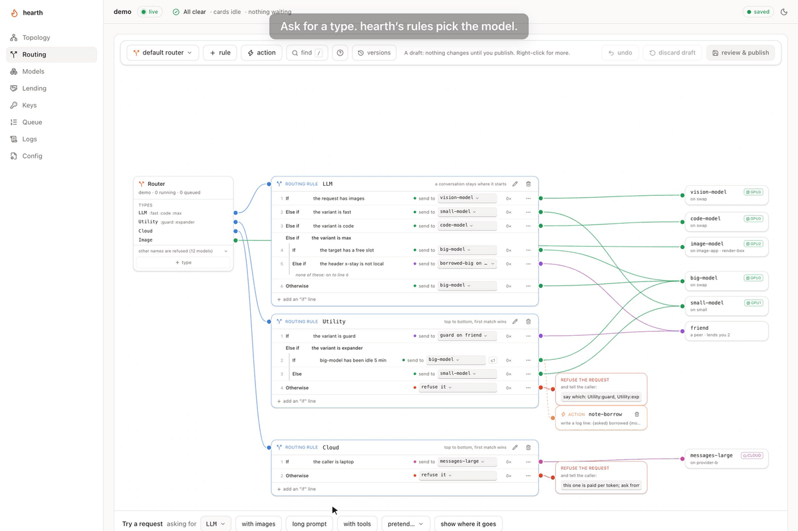
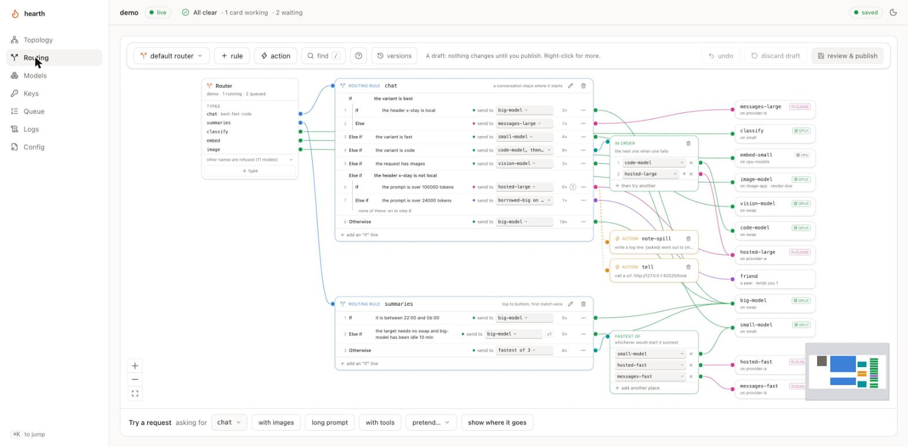
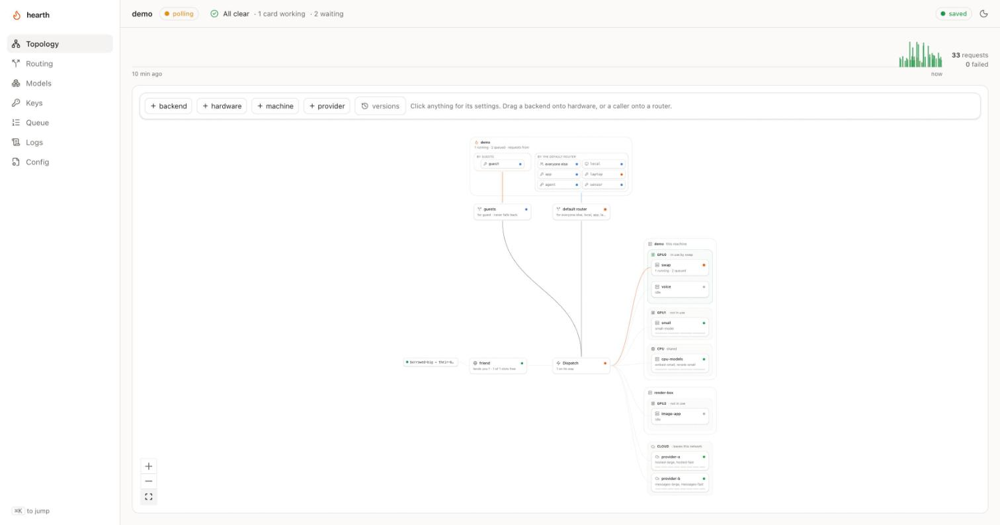

# hearth

[](https://www.npmjs.com/package/@vcvzgbzz/hearth)
[](https://github.com/Vcvzgbzz/hearth/actions/workflows/test.yml)
[](package.json)
[](LICENSE)

A queue in front of your local inference server, and optionally a way to lend
the spare capacity to someone you trust.

One GPU fits one model at a time. The moment two things want different models
from it they thrash, each evicting the other's weights and paying the load tax
over again. hearth is the admission point that stops that. It speaks the OpenAI
API, so nothing you already use has to change.

```bash
npm i -g @vcvzgbzz/hearth
hearth init          # probes for llama-swap / llama.cpp / ollama, writes hearth.yaml
hearth serve
```

Point any client at `http://127.0.0.1:4141/v1` instead of your backend. That's
the whole migration.



No GPU to hand? Clone the repo and run `npm install && npm run demo`: a node
with one of everything and stand-ins behind it, at
<http://127.0.0.1:4300/ui>. The screenshots below are of it. See
[`demo/`](demo/README.md).

## What it does

Three things, and only the first one is mandatory.

**Queues.** Named lanes with priorities, aging so nothing starves, a per-caller
cap, and a preference for whatever model is already loaded.

**Speaks OpenAI.** `/v1/chat/completions` and `/v1/models`, streaming included.
Bodies pass through byte-for-byte, so tool calls, vision parts and whatever gets
invented next month keep working.

**Federates, if you want it to.** Point a model at a peer and those requests run
on their machine. They never take a local slot, because they never touch the
local GPU.

## Beyond the queue

Each of these is off until you ask for it in `hearth.yaml`.

- **Routing rules.** A name a client asks for can be a type (`chat`, `chat:fast`)
  and a short list of if / else lines decides which model answers: by the size of
  the prompt, a header, the caller, the time, what is loaded. See
  [Routing](docs/routing.md).

  
- **A console.** `/ui` draws the node, its hardware, its callers and its rules,
  shows the queue and recent requests, and edits the config with a review before
  anything is written. See [The console](docs/console.md).

  
- **Keys.** Each caller can have a key with its own models, expiry, rate and
  daily limits, and its usage in tokens and dollars. See
  [Configuration](docs/configuration.md).
- **More than one backend.** Several servers, several cards, other machines on
  your network, and backends that do not speak the OpenAI API, each queued as
  its hardware allows. See [Backends](docs/backends.md).
- **Cloud providers.** A provider's OpenAI-compatible or Anthropic API as a
  backend, so a rule can send some requests out and keep the rest home. See
  [A provider's models](docs/providers.md).
- **A canary.** Asks each model a question now and then and refuses a model
  that has stopped making sense. See [Canary](docs/canary.md).
- **Sharing.** Lend a model to a friend's node, or borrow one. See
  [Sharing capacity](docs/sharing.md).

## Documentation

| | |
|---|---|
| [Lanes](docs/lanes.md) | priorities, aging, and a ceiling for a lane |
| [Configuration](docs/configuration.md) | every setting in `hearth.yaml`, and api keys |
| [Endpoints](docs/endpoints.md) | every route besides `/v1/chat/completions`, and what `/healthz` checks |
| [The console](docs/console.md) | the page at `/ui`, and changing the config from it |
| [Routing](docs/routing.md) | flows, types and variants, routers per caller, actions |
| [Backends](docs/backends.md) | several servers, shared cards, other machines, non-OpenAI paths |
| [A provider's models](docs/providers.md) | cloud backends, their keys, and Anthropic's API |
| [Models](docs/models.md) | ids and aliases, per-id defaults, kept answers, warm state, warming |
| [Canary](docs/canary.md) | probing models, verdicts, notifications and recovery |
| [Sharing capacity](docs/sharing.md) | peers: lending, borrowing, and what a borrowed model can take |
| [Running it on a server](docs/deploying.md) | systemd, restarts, and what to supervise |
| [Security](docs/security.md) | what is trusted, cross-origin writes, and why not to proxy it |
| [Development](docs/development.md) | embedding it, the tests, and two design notes |

## What it won't do

Better to know this before you deploy it than after.

- The queue lives in memory. SIGTERM drains in-flight requests, queued ones
  included, for up to `shutdownGraceMs` (30 s by default); whatever the grace
  does not cover is lost. Whatever supervises the process is responsible for not
  restarting it constantly.
- Retries only happen before the first byte. If a peer dies mid-stream the
  request fails, because the client already has half an answer and replaying
  would corrupt it. Before any bytes reach the client, failover is invisible.
- Estimates are crude. `fastest` compares queue depth, not predicted duration.
  Depth is a real signal, but a duration model is a research project.
- No rebalancing. A flow's `fastest` spreads one name over several backends as
  each request arrives (see [More than one local backend](docs/backends.md#more-than-one-local-backend)),
  but a job that is queued stays where it was put, and nothing weighs one
  backend against another beyond queue depth and what is loaded.
- No end-user auth. `apiKeys` is a coarse gate. Per-account fairness belongs in
  the application, which is the thing that knows who the accounts are.
- Only chat completions and the paths a backend declares under `routes` are
  queued. `/v1/embeddings`, `/v1/completions` and everything else pass through
  unscheduled unless you name them there. See [Backends that don't speak the
  OpenAI API](docs/backends.md#backends-that-dont-speak-the-openai-api).

## Security

The defaults assume a private network. hearth binds to `127.0.0.1`; with no
`apiKeys`, loopback is the only thing trusted; lending is opt-in per model; and
nothing leaves the machine unless your config names a peer or a cloud backend.
Do not put a reverse proxy in front of it. [Security](docs/security.md) has the
whole of it, and is worth reading before you widen `listen`. Found a
vulnerability? Report it privately: see [`SECURITY.md`](SECURITY.md).

## Development

```bash
npm run typecheck                  # server, tests and the console
npm test                           # assert-based, each file runs standalone
npx tsx test/<name>.test.ts        # one file; `npm run build:console` first for page tests
npm run build
```

[Development](docs/development.md) covers embedding it and how the tests are
laid out. To contribute, start with [`CONTRIBUTING.md`](CONTRIBUTING.md);
[`AGENTS.md`](AGENTS.md) has the full rules for commits, comments and pull
requests, for people and AI agents alike.

MIT.
