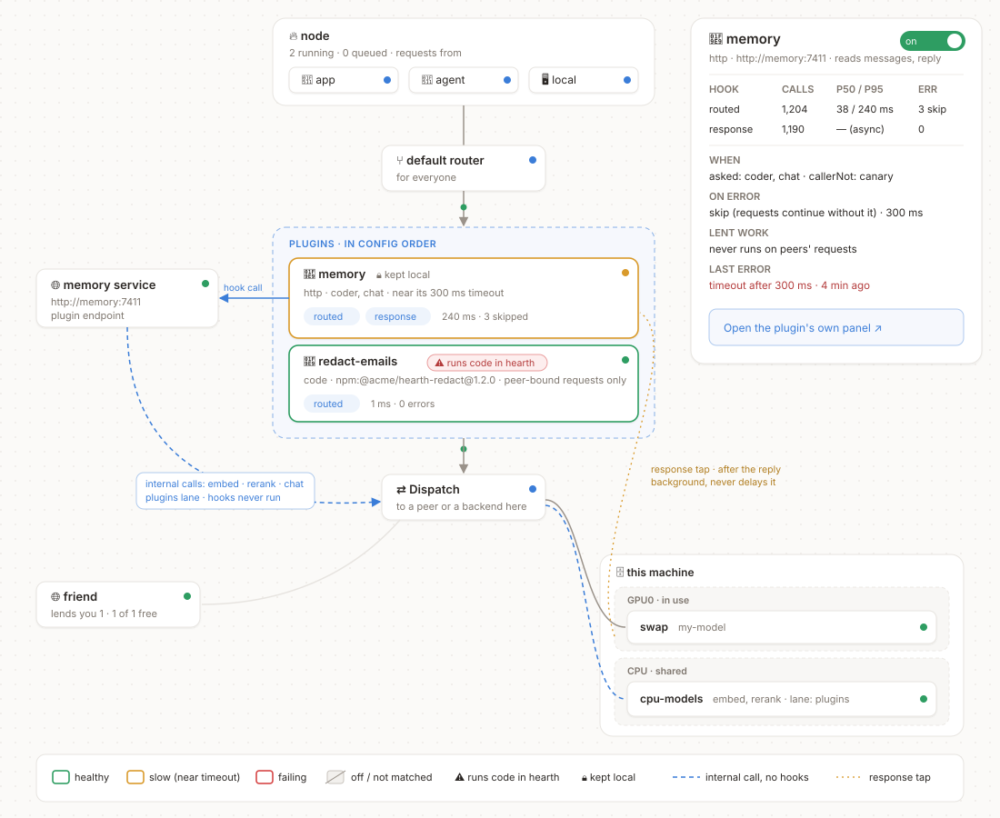

# Plugins (RFC)

**Status: proposal.** Nothing here is built yet. Comments welcome on the tracking issue.

A plugin changes or watches what passes through hearth: it can rewrite a request before it runs, keep a
request on this machine, refuse it, or read the finished exchange. Plugins are written by anyone, in any
language, and run either inside hearth or as their own service.



## Why

hearth already decides *where* a request runs (flows, peers, lanes) and can set something off when it
does (`actions:`). Actions are observers by design: they never change a request, never hold it up, and
see only facts about it, never the messages. Some jobs need more than that:

- **Memory**: recall what a user saved and add it to the prompt, then hand the finished conversation to a
  memory service.
- **Privacy**: scrub email addresses from a request before it leaves for a peer, or keep it here.
- **Safety**: refuse a request a policy model flags, before it reaches a backend.
- **Audit**: record exchanges somewhere of the operator's choosing.

Each of these needs to read the messages, change them, or both, at a point in the request that hearth
controls. Building each one into hearth does not scale, and every operator wants a different one.

## Goals

- Anyone can write a plugin, in any language.
- Plugins are composable: several run on one request, in an order the operator sets.
- A plugin cannot break hearth's guarantees: no deadlock, no request loops, no peer's prompts handed to a
  plugin without the operator choosing it, and hearth keeps serving when a plugin fails.
- Running someone else's code is an explicit choice, visible in the config and the console.

## Non-goals

- Replacing flows. Flows decide where a request runs; plugins decide what happens to it on the way. A
  plugin never picks a backend or a peer, though it can require that a request stays on this machine.
- Sandboxing in-process code. A `code` plugin can do anything hearth can. The protection is that the
  operator chooses it, by name and version.
- A marketplace or registry. Plugins are npm packages, files or URLs.

## Two kinds of plugin

| | `code` | `http` |
|---|---|---|
| What it is | A JavaScript module loaded into hearth | A service hearth calls over HTTP |
| Written in | JavaScript or TypeScript | Anything |
| Trust | Full: it runs inside hearth with hearth's access | Isolated: it sees only what hearth sends it |
| Cost per hook | A function call | A local HTTP round trip |
| Source | `npm:@scope/name@1.2.3` (exact version, optional integrity hash) or `file:./plugins/x.js` | `http://host:port/path` |

Both implement one interface. The `http` kind is a built-in adapter that turns hook calls into requests.

## Configuration

```yaml
plugins:
  memory:
    use: http://memory:7411/hooks/hearth
    trust: http
    when: { asked: [chat, coder], callerNot: [canary] }   # the conditions flow steps use
    hooks:
      routed:   { timeoutMs: 300, onError: skip }          # requests go on without it
      response: {}                                          # after the reply, in the background
    reads: [messages, reply]                                # what hearth sends an http plugin
    peers: false                                            # never on requests peers send here
    config: { userHeader: x-memory-user }                   # the plugin's own settings

  redact-emails:
    use: npm:@acme/hearth-redact@1.2.0
    trust: code                                             # required for anything that runs in hearth
    when: { asked: [chat] }
    hooks:
      routed: { onError: refuse }                           # a privacy plugin fails closed
```

- Plugins run in the order they are listed. The first refusal ends the chain.
- `when` takes the same conditions as a flow step (`asked`, `caller`, `lane`, `header`, `tools`,
  `tokensOver` and the rest). A request that does not match skips the plugin.
- `trust: code` is required to load a `code` plugin. hearth refuses to start with a `code` plugin that
  lacks it, so copying a config line never runs code by accident.
- `onError` is `skip` (the default: the request continues as if the plugin were not there) or `refuse`
  (the request fails with the plugin's error).
- `config` is passed to the plugin as is. A plugin may publish a schema, which the console's config
  editor uses to check the section.
- `hearth serve --no-plugins` starts with every plugin off, for recovering from a broken one.

## Hooks

| Hook | When | May | Holds the client? |
|---|---|---|---|
| `request` | After admission, before routing | rewrite the body, set or remove headers, set the lane, keep it local, refuse | yes, up to `timeoutMs` |
| `routed` | After routing decides `local` or `peer`, before the request is queued | the same as `request` | yes, up to `timeoutMs` |
| `stream` | For each chunk of a streamed reply | read; transform only with `transform: true` | only when transforming |
| `response` | After the reply has finished | read the exchange | no |
| `error` | When the request failed | read | no |
| `events` | Queue, peer and eviction events | read | no |
| `routes` | Requests to `/plugins/<name>/*` | answer them (a plugin's own API or page) | n/a |

A `request` or `routed` hook returns a decision:

```ts
type Decision =
  | void                                       // continue unchanged
  | {
      body?: Record<string, unknown>;          // the whole chat body, replaced
      headers?: Record<string, string | null>; // set, or null to remove; never authorization
      lane?: string;
      stayLocal?: true;                        // this request must not leave this machine
      refuse?: { status: number; message: string };
    };
```

- A body that changes after routing is measured again. If it no longer fits where it was routed, it is
  routed once more; a second change of fit is refused rather than routed again.
- A changed body must still be a valid chat request, under the size limit. hearth checks before using it.
- `stayLocal` can only narrow. A request already kept local stays local whatever a later plugin says.

### What a `routed` hook sees

```ts
interface Routed {
  id: string;                      // the request id hearth logs
  asked: string;                   // the model the client asked for
  model: string;                   // the model it runs as
  target: "local" | "peer";        // where routing sent it
  peer: string | null;
  caller: string;                  // an api key's label, or "local"
  lane: string;
  headers: Record<string, string>; // the client's headers, minus authorization
  body: Record<string, unknown>;   // the chat request
}
```

`request` sees the same without `model`, `target` and `peer`. `response` adds `reply` (the assistant
message, assembled from the stream when there was one), `usage`, `status` and timings.

## Writing a `code` plugin

```ts
import { definePlugin } from "@vcvzgbzz/hearth/plugin";

export default definePlugin({
  name: "redact-emails",
  apiVersion: 1,
  setup(ctx) {
    return {
      routed: async (r) => (r.target === "peer" ? { body: redact(r.body) } : undefined),
    };
  },
});
```

`setup` receives a context:

| | |
|---|---|
| `ctx.config` | the plugin's `config` section |
| `ctx.models.chat / embed / rerank` | calls into hearth's own scheduler, on the `plugins` lane, marked internal (below) |
| `ctx.log` | hearth's logger, prefixed with the plugin's name |
| `ctx.store` | a small key-value store under hearth's state directory, one per plugin |
| `ctx.metrics` | counters and timings shown on the plugin's console panel |
| `ctx.every(ms, fn)` | a timer that stops with the plugin |

## Writing an `http` plugin

hearth sends one POST per hook to the plugin's URL:

```json
{
  "apiVersion": 1,
  "hook": "routed",
  "request": { "id": "…", "asked": "chat", "model": "chat", "target": "local", "peer": null,
               "caller": "app", "lane": "interactive", "headers": { "x-memory-user": "u1" },
               "body": { "model": "chat", "messages": [ … ] } },
  "internal": { "url": "http://127.0.0.1:4141", "token": "…" }
}
```

and expects the decision back:

```json
{ "decision": { "body": { "model": "chat", "messages": [ … ] } } }
```

- Only the fields in `reads` are sent: a plugin that reads `[headers]` never receives a message.
- For `response`, hearth sends the exchange and ignores the answer.
- `internal.token` lets the plugin call hearth's `/v1` endpoints back as internal traffic, for the
  length of the hook call only.

## Guarantees

hearth enforces these whatever a plugin does:

1. **No deadlock.** Blocking hooks run before a request holds a slot. A plugin's own model calls queue
   on the `plugins` lane. `response` runs after the slot is released.
2. **No loops.** A plugin's own model calls are internal, and hooks never run on internal traffic.
3. **Bounded.** Every blocking hook has a timeout, every plugin an `onError`, every body a size limit.
4. **Peers' work is private.** Hooks do not run on requests a peer sends here unless `peers: true`, and a
   plugin that does is listed in what this node tells its borrowers.
5. **Recoverable.** A plugin that fails to start is turned off and logged; hearth keeps serving unless the
   plugin is `required: true`. Any plugin can be turned off live from the console, and
   `--no-plugins` starts with none.

## In the console

Plugins are blocks on the Topology map, in the path between routing and Dispatch, in the order they run.

- **Edges.** Requests flow through the blocks. An `http` plugin's service is its own block, with a
  dashed edge back into Dispatch for its internal calls. A `response` hook is a dotted tap off the
  return path.
- **State, by colour.** Green outline: healthy. Amber: near its timeout. Red: failing. Grey and struck
  through: off, or skipped by `when`.
- **Badges.** ⚠ for a `code` plugin (it runs inside hearth). 🔒 when it kept a request local.
- **Panel.** Clicking a block opens its numbers per hook (calls, p50/p95, errors, skips), its `when`, its
  `onError`, whether it runs on peers' work, its last error, an on/off switch, and the plugin's own
  page if it serves one under `/plugins/<name>/ui`, shown in a sandboxed frame.
- **Per request.** The recent-requests rail and the logs show which plugins ran on a request and how
  long each took.

On the Routing map, a plugin is a chip on each flow whose inputs its `when` matches. It is not a step: it
does not decide where a request goes.

## Changes to hearth

| | Change | Size |
|---|---|---|
| C1 | One request context carried through admission, routing, queueing, sending and relaying, in place of the positional arguments passed between those stages today. No behaviour change. | large |
| C2 | Measure and route again, once, when a hook changes a body after routing. | medium |
| C3 | Assemble the reply from a relayed stream without delaying it, for `response`. | medium |
| C4 | Internal model calls: in-process for `code`, a scoped token for `http`; the `plugins` lane; hooks skip internal traffic. | medium |
| C5 | `stayLocal` as a routing constraint, not a header a flow has to test for. | small |
| C6 | The plugin runtime: loader, lifecycle, `plugins:` config and its fields, timeouts, metrics, `--no-plugins`. | medium |
| C7 | Hooks off for peers' requests by default; `peers: true` shown in lending terms. | small |
| C8 | Console: plugin blocks and panels on the Topology map, chips on the Routing map, a per-request plugin trace. | medium |

## Order of work

1. C1 and C5, with no plugin API: the existing tests show nothing changed.
2. C2 to C4, C6 and C7: `request`, `routed` and `response` for both kinds, each guarantee with a test that
   tries to break it (a hook that calls back into the same model, a hook that never answers, a plugin
   that throws on start).
3. A first real plugin over `http` (memory), run in production.
4. C8, then `stream`, `events` and `routes`.
5. A second, unrelated plugin (a safety check). Then `apiVersion: 1` is frozen, documented with
   examples, and a starter template is published.

## Alternatives considered

- **Extend `actions:`.** Actions are deliberately unable to change or delay a request, and other parts of
  hearth rely on that. Plugins sit beside them; `events` is the superset of what actions observe.
- **`http` only.** Simpler to make safe, but every hook pays a network hop and plugins cannot use
  hearth's scheduler in-process. Operators who want in-process code would fork instead.
- **The plugin service computes embeddings itself, or hearth computes them for it.** The first bypasses
  hearth's queue for that hardware; the second ties hearth to one plugin's internals. Internal calls (C4)
  keep both apart.
- **A WebAssembly sandbox for `code`.** Real isolation, at the cost of most of the npm ecosystem and a
  much harder plugin API. Possible later as a third kind; nothing here rules it out.

## Open questions

- Should `code` plugins also need a node-wide `allowCodePlugins: true`, or is `trust: code` per plugin
  enough?
- Should a plugin's own page live in hearth's console (a panel) or only at its own address?
- Should `stream` transforms exist at all, given that an output filter can also run as `response` plus a
  refusal on the next turn?
