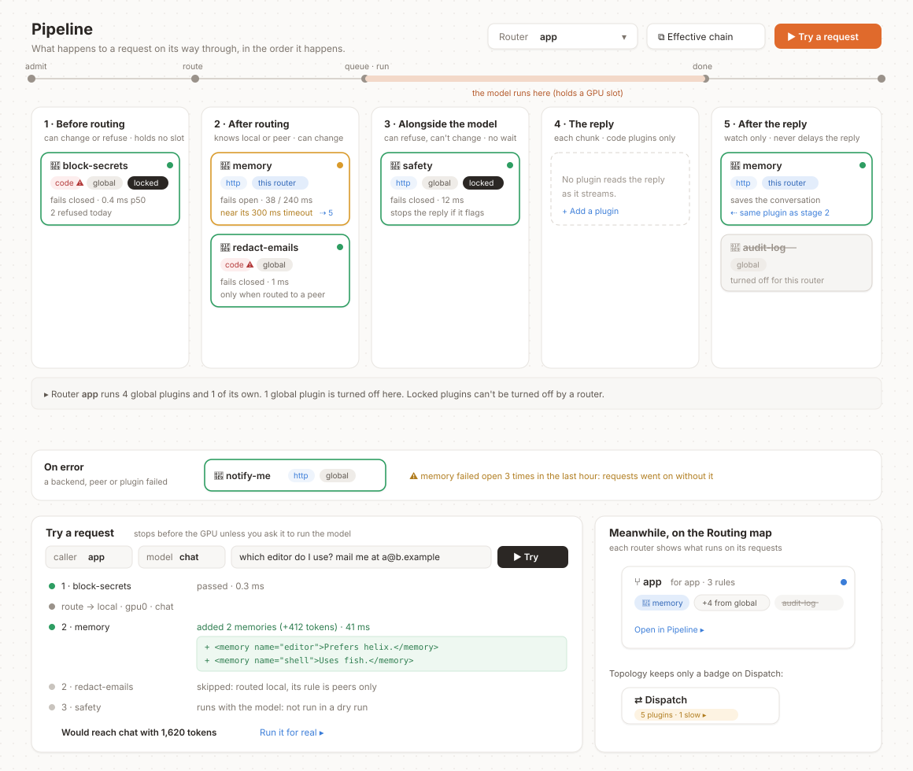

# Plugins (RFC)

**Status: partly built.** Chat requests run `request`, `routed`, `log` and `error` hooks for both kinds of
plugin, with the guarantees below. The other stages, the other request kinds, plugins on peers' requests
and the console are not built yet (tracking: #191); requests of other kinds run no plugins.

A plugin changes or watches what passes through hearth: it can rewrite a request before it runs, keep a
request on this machine, refuse it, check the reply, or read the finished exchange. Plugins are written
by anyone, in any language, and run either inside hearth or as their own service.



## Why

hearth already decides *where* a request runs (flows, routers, peers, lanes) and can set something off
when it does (`actions:`). Actions are observers by design: they never change a request, never hold it
up, and see only facts about it, never the messages. Some jobs need more than that:

- **Memory**: recall what a user saved and add it to the prompt, then hand the finished conversation to a
  memory service.
- **Privacy**: scrub email addresses from a request before it leaves for a peer, or keep it here.
- **Safety**: refuse a request, or stop a reply, that a policy model flags.
- **Audit**: record exchanges somewhere of the operator's choosing.

Each needs to read the messages, change them, or both, at a point hearth controls. Building each into
hearth does not scale, and every operator wants a different one.

## Goals

- Anyone can write a plugin, in any language.
- Plugins compose: several run on one request, in an order the operator can see.
- A plugin cannot break hearth's guarantees: no deadlock, no request loops, no peer's prompts handed to a
  plugin without the operator choosing it, and hearth keeps serving when a plugin fails.
- Running someone else's code is an explicit choice, visible in the config and the console.

## Non-goals

- Replacing flows. Flows decide where a request runs; plugins decide what happens to it on the way. A
  plugin never picks a backend or a peer, though it can require that a request stays on this machine.
- Sandboxing in-process code. A `code` plugin can do anything hearth can. The protection is that the
  operator chooses it, by name, exact version and hash.
- A marketplace or registry. Plugins are npm packages, files or URLs.

## Two kinds of plugin

| | `code` | `http` |
|---|---|---|
| What it is | A JavaScript module loaded into hearth | A service hearth calls over HTTP |
| Written in | JavaScript or TypeScript | Anything |
| Trust | Full: it runs inside hearth with hearth's access | Isolated: it sees only what hearth sends it |
| Cost per hook | A function call | A local HTTP round trip |
| Source | `npm:@scope/name@1.2.3` with `integrity:` (an exact version and its hash), or `file:./plugins/x.js` | `http://host:port/path` |
| Stages | all | all but `stream` |

Both implement one interface; the `http` kind is a built-in adapter. A `code` plugin is loaded only at
startup, never updated in place, and only with `trust: code` on that plugin.

## Stages

A request passes through fixed steps (admit, route, queue and run, reply). Plugins hook the stages
between them:

| Stage | When | May | Holds the client? |
|---|---|---|---|
| `request` | after admission, before routing | change the body or headers, set the lane, keep it local, refuse | yes, up to `timeoutMs` |
| `routed` | after routing decides `local` or `peer`, before queueing | the same | yes, up to `timeoutMs` |
| `parallel` | while the model runs | refuse (the reply is stopped); never change | no |
| `stream` | each chunk of a streamed reply (`code` only) | read; change only with `transform: true` | only when changing |
| `response` | the whole reply | refuse or change it, as its `stream` policy allows | see below |
| `log` | after the last byte | read the exchange | no, runs in the background |
| `error` | a backend, peer or plugin failed | read | no |

Separately, a plugin may answer `routes` (requests to `/plugins/<name>/*`, its own API or page) and
`events` (queue, peer and eviction events, a superset of what `actions:` see).

### Streamed replies

A reply that has been streamed to the client cannot be taken back. A plugin with a `response` hook says
which of these it wants for streamed replies, and the console shows it:

- `audit` (the default): the hook runs after the stream ends and can only record. Shown as *cannot block
  streamed replies*.
- `buffer`: the reply is held until the hook passes it. Streaming is lost for that request.
- `holdback: <characters>`: that many characters are held behind the stream, so the hook can stop the
  reply before its last part leaves.

### Order

Within a stage, plugins run in the order they are listed. There are no priority numbers. Every plugin
whose `request` or `routed` hook ran gets its `log` and `error` hooks, in the reverse order, so a plugin
that opens something can always close it.

## Request kinds

Not every request is a chat. hearth also serves embeddings, reranking, images, video and speech, and
passes through requests it does not understand at all. A plugin written for one kind is wrong, or
harmful, on another: a memory plugin has no business on an image model. So every request has a kind,
and a plugin only ever sees the kinds it says it handles.

| Kind | Where it comes from |
|---|---|
| `chat` | `/v1/chat/completions`, `/v1/messages` |
| `embeddings` | `/v1/embeddings` |
| `rerank` | `/v1/rerank` |
| `image`, `video`, `speech`, `transcription` | the OpenAI paths for them, or a backend route that declares it |
| `other` | anything hearth passes through without understanding it |

```yaml
backends:
  - name: images
    routes:
      - { path: /generate, kind: image }     # a custom path, said to carry image requests
models:
  my-image-model: { kind: image }            # lets config naming this model be checked
```

- **hearth decides the kind.** It comes from the path the request arrived on and the route that took it.
  A client cannot set it, and neither can a plugin.
- **A plugin's own declaration is the ceiling.** A plugin lists the kinds it handles and the stages it
  hooks for each. hearth never calls it for any other kind, on every request, whatever the config says.
- **Config can narrow, never widen, and is checked when it loads:**
  - `kinds: [image]` on a plugin that handles only chat is refused: *memory handles chat; image is not
    one of its kinds*.
  - `when: { asked: [my-image-model] }` on that plugin is refused: *memory handles chat;
    my-image-model is an image model*.
- **`other` gets no plugins** unless a plugin declares `other`, and then it gets the raw body and its
  content type.
- **Not every stage exists for every kind:**

| | request | routed | parallel | stream | response | log | error |
|---|---|---|---|---|---|---|---|
| chat | ✓ | ✓ | ✓ | ✓ | ✓ | ✓ | ✓ |
| embeddings, rerank | ✓ | ✓ | | | ✓ | ✓ | ✓ |
| image, video, speech, transcription | ✓ | ✓ | | | ✓ | ✓ | ✓ |
| other | ✓ | | | | | ✓ | ✓ |

  Requests other than chat are never sent to peers, so for them `routed` is always `local`.
- **Bodies.** A kind that arrives on a standard path gets a body hearth checks the shape of (messages for
  chat, `input` for embeddings, a prompt and settings for images). A custom route says only its kind:
  its body reaches the plugin as sent, and a plugin written for that server can still read it. Image,
  video and audio replies reach a plugin as their size, type and duration, never their bytes, unless it
  declares `reads: [output]`.

## Configuration

Plugins are defined once, under `plugins:`. Each applies everywhere unless a router says otherwise.

```yaml
plugins:
  memory:
    use: http://memory:7411/hooks/hearth
    trust: http
    kinds: { chat: [routed, log] }               # within what the plugin itself declares
    when: { asked: [chat, coder] }              # the conditions flow steps use
    reads: [messages, reply]                     # all an http plugin is ever sent
    timeoutMs: 300
    onError: skip                                # the plugin is down or slow: carry on without it
    config: { userHeader: x-memory-user }        # the plugin's own settings

  safety:
    use: http://guard:8080/hearth
    trust: http
    kinds: { chat: [parallel] }
    locked: true                                 # no router can turn it off
    onFail: refuse                               # it flagged the request
    onError: refuse                              # it could not answer: fail closed

  redact-emails:
    use: npm:@acme/hearth-redact@1.2.0
    integrity: sha512-…
    trust: code                                  # required to run code inside hearth
    kinds: { chat: [routed] }
    when: { target: peer }

routers:
  app:
    plugins: { audit-log: off }                  # this router turns a global plugin off
  local:
    plugins: { memory: off }
```

`kinds` may be left out, and the plugin then hooks everything it declares; when given, it may only name
kinds and stages the plugin declares.

- **Two levels only.** A plugin is global, and a router may turn it `off` or give it different settings
  (`{ config: … }`, which replaces the global settings for that router). It still runs once.
- `locked: true` means no router can turn it off or weaken it. Safety and privacy plugins are locked.
- `when` uses the flow-step conditions plus `target: local | peer`. A request that does not match skips
  the plugin, and the trace says so.
- **Two failures, two policies.** `onFail` is what happens when a plugin says no (`refuse`, or `flag` to
  let the request through and mark it). `onError` is what happens when it cannot answer: `skip`
  (fail open) or `refuse` (fail closed). Every fail-open is counted, shown on the plugin and reported
  through `error` plugins, so a plugin that keeps failing open is noticed.
- A plugin that fails `onError` past a threshold is paused for a while (a circuit breaker), then tried
  again; its policy decides what requests get meanwhile.
- `hearth serve --no-plugins` starts with every plugin off, for recovering from a broken one.

## What a hook returns

```ts
type Decision =
  | void                                       // continue unchanged
  | {
      body?: Record<string, unknown>;          // the whole chat body, replaced
      headers?: Record<string, string | null>; // set, or null to remove; never authorization
      lane?: string;
      stayLocal?: true;                        // this request must not leave this machine
      refuse?: { status: number; message: string };
      flag?: string;                           // let it through, marked, with a reason
    };
```

- A refusal before the model runs never reaches the queue, and is one OpenAI-shaped error to the client.
- A body that changes after routing is measured again; if it no longer fits where it was routed, it is
  routed once more, and a second change of fit is refused.
- A changed body must still be a valid chat request, under the size limit.
- `stayLocal` can only narrow: a request kept local stays local whatever a later plugin says.

### What a hook sees

```ts
interface Routed {
  id: string;
  asked: string;                   // the model the client asked for
  model: string;                   // the model it runs as
  target: "local" | "peer";
  peer: string | null;
  caller: string;                  // an api key's label, or "local"
  router: string;
  lane: string;
  headers: Record<string, string>; // the client's, minus authorization
  body: Record<string, unknown>;
}
```

`request` sees the same without `model`, `target` and `peer`. `response`, `log` and `error` add the reply,
usage, status and timings.

## Writing a `code` plugin

```ts
import { definePlugin } from "@vcvzgbzz/hearth/plugin";

export default definePlugin({
  name: "redact-emails",
  apiVersion: 1,
  kinds: { chat: ["routed"] },            // hearth never calls it for anything else
  setup(ctx) {
    return { routed: async (r) => ({ body: redact(r.body) }) };
  },
});
```

`setup` receives `ctx.config` (its settings), `ctx.models.chat / embed / rerank` (calls into hearth's
scheduler, marked internal, below), `ctx.log`, `ctx.store` (a small key-value store per plugin),
`ctx.metrics` and `ctx.every(ms, fn)`.

## Writing an `http` plugin

hearth sends one POST per hook, with `Authorization: Bearer <key>` when the plugin sets `key` (`env:NAME`):

```json
{
  "apiVersion": 1,
  "hook": "routed",
  "kind": "chat",
  "dryRun": false,
  "request": { "id": "…", "asked": "chat", "model": "chat", "target": "local", "peer": null,
               "caller": "app", "router": "app", "lane": "interactive",
               "headers": { "x-memory-user": "u1" }, "body": { "model": "chat", "messages": [ … ] } },
  "internal": { "url": "http://127.0.0.1:4141", "token": "…" }
}
```

and expects `{ "decision": { … } }` back. An `http` plugin states its kinds and stages at
`GET {url}/manifest`, which hearth reads at startup and holds it to. Only the fields in `reads` are sent. `log` and `error` calls are
not answered. `internal.token` lets the plugin call hearth's `/v1` back as internal traffic, during a hook or later
(a memory service extracting in the background); it is the plugin's alone and changes when hearth restarts.

A plugin with a page of its own serves it under its URL and declares it; hearth adds a sidebar entry and
proxies the page at `/plugins/<name>/`, checking the operator's login itself and passing who is viewing
in headers. The page is shown in a sandboxed frame, so it never runs with the console's own access.

## Guarantees

1. **No deadlock.** `request` and `routed` run before a request holds a slot; a plugin's own model calls
   queue on the `plugins` lane; `log` runs after the slot is released.
2. **No loops.** A plugin's own model calls are internal, and no hook runs on internal traffic. Internal
   is a property hearth gives the call itself (the token it hands each plugin), never a header a
   client could send.
3. **Bounded.** Every blocking hook has a timeout, every plugin an `onError`, every body a size limit.
4. **Peers' work is private.** Hooks do not run on requests a peer sends here unless the plugin says
   `peers: true`, and such a plugin is listed in what this node tells its borrowers.
5. **Recoverable.** A plugin that fails to start is turned off and logged, and hearth keeps serving unless
   it is `required: true`. Any plugin can be paused live from the console; `--no-plugins` starts with none.
6. **Kinds are kept apart.** A plugin is only called for the kinds it declares, checked on every
   request, and config that would attach it to another kind fails to load.
7. **No secrets in traces.** A trace never records authorization headers or keys, and prompt text is kept
   only if the operator turns that on.

## In the console

Plugins get their own page, **Pipeline**, because they are about *when* things happen to a request, not
*where* it runs (Topology) or *which* model it gets (Routing).

- **Stages as columns,** in the order a request meets them, with the fixed steps (admit, route, queue and
  run, done) drawn above them. Each plugin is a card in the stage it hooks; a plugin with two hooks
  appears in both, linked. An On error lane runs underneath.
- **A tab per kind** (Chat, Embeddings, Images, Video, Speech, Other), each with its count. A tab shows
  only the stages that kind has and only the plugins that handle it, so an image model's pipeline is
  visibly its own: a chat-only plugin is never offered there. A plugin's panel lists its kinds.
- **A router picker.** The page shows the chain for one router: global plugins it runs, its own changes,
  and plugins it turned off (struck through). A line under the stages says how many come from global and
  that locked ones cannot be turned off. **Effective chain** lists exactly what runs, in order, as a
  flat list.
- **Cards** show the kind (`http`, or `code` with ⚠), the scope (`global`, `this router`, `locked`), the
  failure policy, timing, and health by outline: green healthy, amber near its timeout, red failing,
  grey off or not matched. Clicking one opens its numbers per hook, its `when`, its last error, a pause
  switch and its own page if it has one.
- **Try a request.** Pick a caller and a model, type a message, and see every stage in order: each
  plugin's verdict and time, what it changed as a diff, what was skipped and why, and where the request
  would run. It stops before the model unless asked to run it; `parallel` and `log` plugins are listed,
  not run. Plugins receive `dryRun: true` and must not keep anything from a dry run.
- **Each logged request** opens the same view as a record of what happened.
- **Elsewhere.** On the Routing map, each router shows its plugins as chips (its own, a count from
  global, and any it turned off), linking to Pipeline. Topology keeps only a badge on Dispatch
  (*5 plugins · 1 slow*). Plugin pages are sidebar entries.

## Changes to hearth

| | Change | Size |
|---|---|---|
| C1 | One request context carried through admission, routing, queueing, sending and relaying, in place of the positional arguments passed between those stages today. No behaviour change. | large |
| C2 | Measure and route again, once, when a hook changes a body after routing. | medium |
| C3 | Assemble the reply from a relayed stream; `buffer` and `holdback` for `response`. | medium |
| C4 | Internal model calls: a token per plugin, made at startup and gone with a restart; no hooks on internal traffic. | medium |
| C5 | `stayLocal` as a routing constraint, not a header a flow has to test for. | small |
| C6 | The runtime: loader, lifecycle, `plugins:` and `routers.<name>.plugins`, timeouts, `onFail` / `onError`, the circuit breaker, metrics, `--no-plugins`. | medium |
| C7 | Hooks off for peers' requests by default; `peers: true` shown in lending terms. | small |
| C9 | Request kinds: on the request context, `kind:` on backend routes and models, the per-request gate, checks at load, body shapes per kind. | medium |
| C8 | Console: the Pipeline page and its kind tabs, Try, the per-request record, router chips, the Dispatch badge, plugin pages proxied into the sidebar. | large |

## Order of work

1. C1, C5 and C9, with no plugin API. The existing tests show nothing changed, and every request carries
   its kind.
2. C2, C4, C6 and C7 with `request`, `routed`, `log` and `error` for both kinds. Each guarantee gets a test
   that tries to break it: a hook that calls back into the same model, one that never answers, one that
   throws on start, a client that sends the internal marker itself, a chat plugin attached to an image
   model in the config and in a hand-built request.
3. A first real plugin over `http` (memory), in production.
4. C3 with `parallel`, `response` and `stream`; then C8.
5. A second, unrelated plugin (a safety check). Then `apiVersion: 1` is frozen, documented with examples,
   and a starter template is published.

## Alternatives considered

- **Extend `actions:`.** Actions are deliberately unable to change or delay a request, and other parts of
  hearth rely on that. Plugins sit beside them; `events` is the superset of what actions observe.
- **Plugins on the Topology map.** Topology shows machines, hardware, peers and callers. Plugins are steps
  in time, and drawing them as places made the map harder to read.
- **Plugins as steps inside flows.** Flows choose where a request goes; mixing "what happens to it" into
  the same rules turns them into a program.
- **More scope levels** (per caller, per model, per key) with precedence rules. Each level adds a way for
  a plugin to run or not run that nobody can see. Two levels, and `when` for the rest.
- **Priority numbers** for order. Ties and per-machine differences make the real order hard to know;
  list order within a stage is what you see.
- **`http` only.** Simpler to make safe, but every hook pays a network hop and plugins cannot use hearth's
  scheduler in-process; operators who want that would fork.
- **A WebAssembly sandbox for `code`.** Real isolation, at the cost of most of the npm ecosystem and a
  harder API. Possible later as a third kind.

## Open questions

- Should `code` plugins also need a node-wide `allowCodePlugins: true`, or is `trust: code` enough?
- Should Try be able to run `parallel` plugins against a reply it supplies, so a safety check can be
  tried without running the model?
- How long should per-request records keep prompt text, when the operator turns that on?
